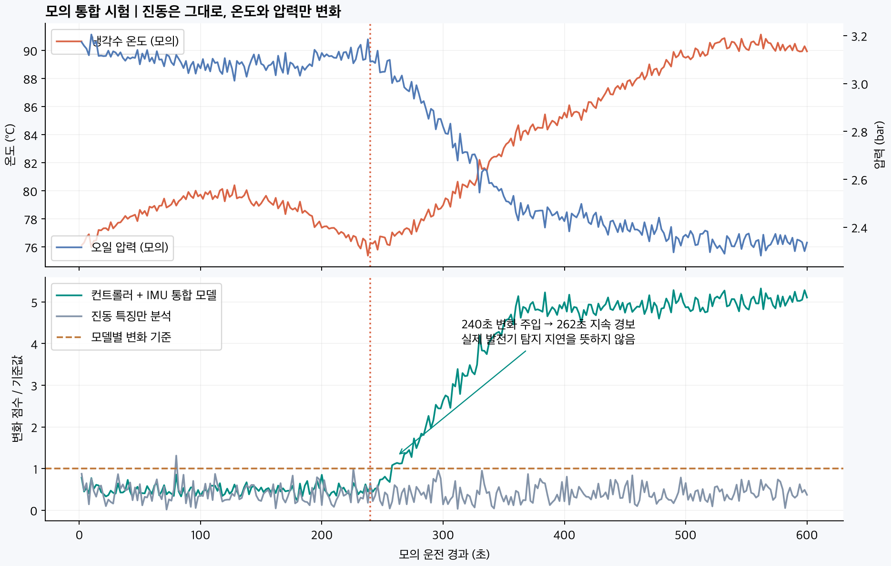
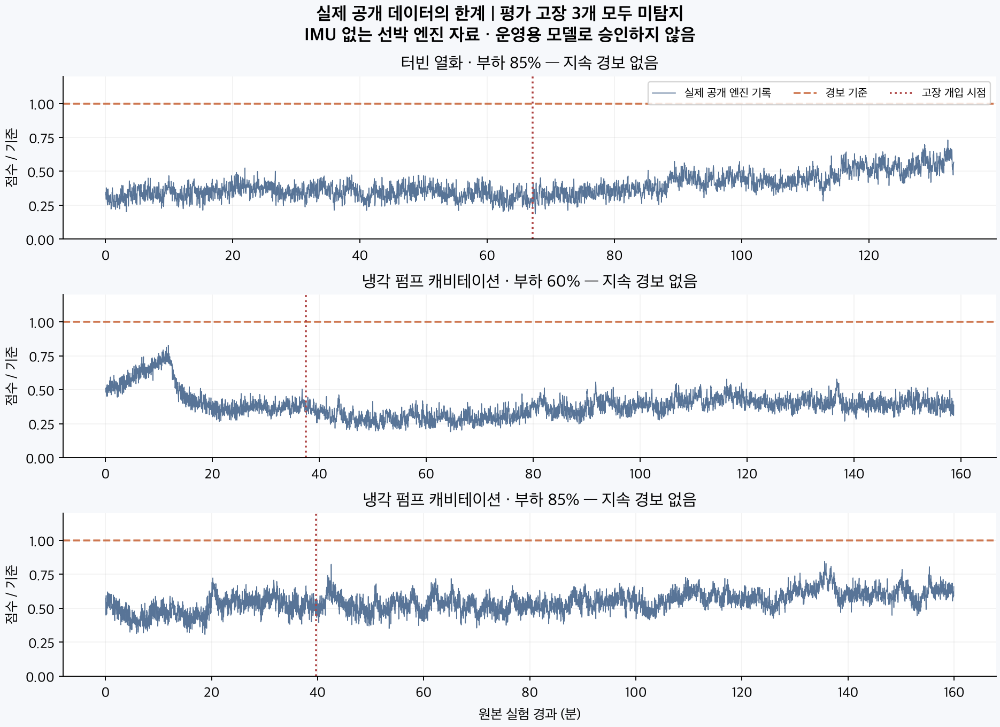

# 검증 결과 — 기능 동작과 실제 고장 성능을 분리

## 1. 컨트롤러 + IMU 통합 시험: 합성 데이터

모든 입력은 코드로 만든 모의 운전입니다. 학습4회, 기준 보정2회, 정상 검증2회, 별도 시험5회로 나눴습니다. 비교 모델도 같은 부하·외기온 정보를 받으며, 학습 대상 채널만 다릅니다.

| 시나리오 | 통합 모델 | 진동 특징만 분석 |
|---|---|---|
| 정상 모의 운전 | 지속 경보 없음 | 지속 경보 없음 |
| 240초부터 온도 상승·유압 하락, 진동 유지 | 262초 지속 경보 | 지속 경보 없음 |
| 240초부터 진동 증가 | 244초 지속 경보 | 244초 지속 경보 |
| 컨트롤러 값 오래됨 | unknown | 진동 비교는 계속 가능 |
| 학습하지 않은 부하 | unknown | unknown |

22초/4초는 주입 시나리오의 결과입니다. 발전기 고장 예지 시간이나 보드 처리 지연이 아닙니다. 모델이 이미 받고 있는 서로 다른 센서 정보를 함께 사용한다는 기능 증거입니다.

## 2. 실제 공개 엔진 시험: 현재 탐지 성능 부족

[Marine Engine Fault 원본](https://zenodo.org/records/19857425), 선박 디젤엔진 Matsui MU323DGSC. 원본16파일114,770행, CC BY4.0. 이번 모델은 RPM·냉각수 온도·윤활유 온도·두 압력 센서 전압을 함께 분석했습니다. **발전 출력 전압·전류 및 IMU는 원본에 없습니다.** 압력 센서 V를 bar로 바꾸지 않았습니다.

원본 파일 단위로 학습6 / 기준 보정2 / 정상 검증2 / 최종 평가3개를 분리했습니다. 정상 접두 구간과 고장 후 구간이 다른 역할의 split에 걸치지 않습니다. 고장 개입 라벨은 모델 입력에 넣지 않습니다. 999°C 기록은 품질 불량으로 처리했습니다.

| 보류한 시험 | 고장 개입 후 지속 경보 |
|---|---|
| 터빈 열화 · 85% 부하 | 없음 |
| 냉각 펌프 캐비테이션 · 60% 부하 | 없음 |
| 냉각 펌프 캐비테이션 · 85% 부하 | 없음 |

**3개 시험 모두 미탐지했습니다.** 정상 검증의 오경보가 적었다는 사실만으로 좋은 탐지 모델이라고 할 수 없습니다. 공개 엔진 후보는 운영 활성화하지 않았습니다. 학습한 채널에서 나타나는 변화 크기, 실험 간 조건 차이와 모델 가정 등을 추가 검토해야 합니다. 원인은 확정하지 않았습니다.

이 시험은 고장 개입 이후 상태 구분이며 장기 자연 열화나 RUL 시험도 아닙니다. 개선 후 이미 본 최종 평가 파일은 탐색 자료로 취급하고, 새로운 독립 기록으로 다시 검증해야 합니다.

## 3. 소프트웨어·자원 검증

- 코드/스트림 테스트 **53개 통과**. 상세: `verification/review-findings.md`.
- localhost API의 상태, 페이지 커서, 허용 origin, 잘못된 limit 처리 확인. `verification/web-smoke.json`.
- 합성 통합 모델 JSON 약 **4.8KB**, Mac에서 학습 약 **0.078초**, 추론+SQLite 저장 p95 약 **0.24ms**.
- 해당 모의 실험 프로세스 최대 RSS 약 **66MiB**, 공개 데이터 평가 약 **197MiB**. Python·입력/결과 메모리를 포함한 해당 Mac 프로세스의 수치입니다.
- **UNO Q 측정값은 아닙니다.** OS·기존 수집기·웹·다른 프로세스 메모리도 별도입니다. 4GB에서 실행을 검토할 만한 규모이지만 보드 실측을 대체하지 않습니다.

원본 보고서는 `verification/demo-final/report.json`, `verification/public-final/report.json`, `verification/software-checks.json`에 있습니다.

## 전달물의 정확한 상태

통합 학습·추론·저장·연결 코드는 실행 가능하며 모의 기능 검증을 마쳤습니다. 실제 발전기 고장 진단 제품이 완성된 것은 아닙니다. 팀은 UNO Q 실물 인수와 현재 IMU의 반복 정상 기록을 먼저 확보하고, 발전기 확보 후 같은 장비에서 컨트롤러와 IMU를 동시에 수집해 기준을 만들어야 합니다.
