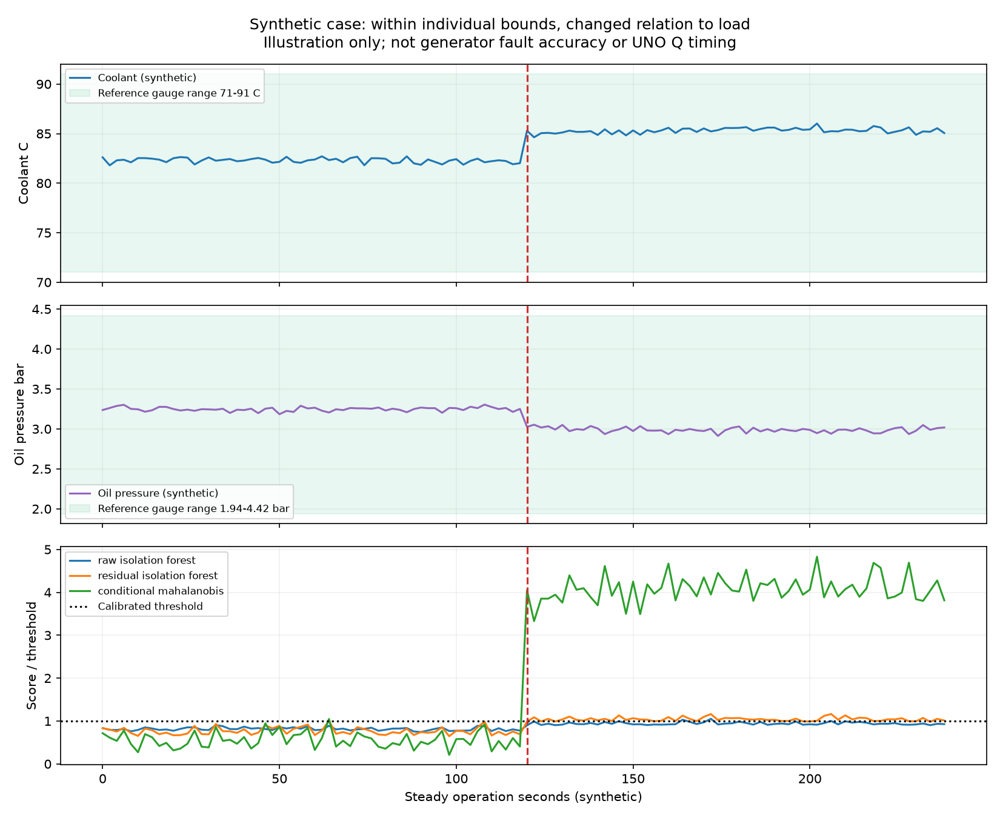

# GenGuard: Isolation Forest 도입 판단과 학습 항목 설계

작성일: 2026-10-10. 기존 `genguard-edge-v1` 코드는 변경하지 않았다. 이 문서는 다음 구현의 판단 자료이며, 첨부 실험은 **가상 신호 실험**이다.

## 판단

**AI를 넣는 목적은 타당하다. 다만 최종 판정은 `자료 품질 확인 → 제조사/운용 규칙 → 해당 장비의 조건별 정상 패턴 → 변화 추세 → 점검 근거 설명`으로 나누는 것이 맞다. Isolation Forest 하나로 전부 해결하지 않는다.**

사용자가 원하는 기능을 나누면 다음과 같다.

| 상황 | 우선 사용할 방식 | 표시할 결과 |
|---|---|---|
| RPM이 정해진 운용 범위 밖 | 명시적 규칙 | 회전수 기준 이탈, 관측값·기준·지속시간 |
| RPM은 정상, 냉각수 온도는 기준 밖 | 센서별 규칙과 종합 상태 병합 | 회전수 정상 / 냉각계통 점검 필요. 정상 RPM이 다른 경보를 상쇄하지 않음 |
| 값은 각각 허용 범위 안이지만 같은 부하·외기온에서 온도↑와 압력↓ | 조건별 정상 모델 + 지속성 확인 | 개별 운용 범위 안 / 평소 관계에서 벗어남 / 추가 점검 권고 |
| 실제 IMU 진동 강도·충격 패턴 변화 | 설치별 진동 기준 + 다변량 모델 | 진동 변화. 체결·설치 상태·부하 변화 등을 먼저 확인하며 고장 부위 확정은 하지 않음 |
| 여러 번의 시험에서 서서히 악화 | 운전별 특징 비교, 기울기·EWMA·변화점 등 별도 추세 분석 | 최근 n회 변화와 최초 기준 대비 편차 |
| 값이 없거나 오래됨, 단위 불일치 | 자료 품질 규칙 | 판단 불가 / 통신·센서 확인. 정상으로 채우지 않음 |
| 오일 교체일·누적 시간 초과 | 제조사 정비 주기 + 날짜/시간 계산 | 정기 정비 예정/초과. 고장 예측 결과와 구분 |

여기서 AI는 머신러닝을 뜻한다. 경량 회귀·공분산 모델도 학습 모델이다. LLM이 없어도 정해진 근거와 점검표를 묶어 한국어 설명을 만들 수 있다. 임계값만 비교하고 이를 AI 분석이라고 표시하지 않는다.

## Isolation Forest가 할 수 있는 것과 못하는 것

Isolation Forest는 여러 특징의 드문 조합에 이상 점수를 줄 수 있는 비지도 학습 방법이다. 원 논문은 작은 부분표본을 활용하는 접근을 제시하고, scikit-learn 구현은 트리 수와 표본 수를 제한할 수 있다. 이는 UNO Q에서 검토할 만한 이유다. **작은 메모리 사용이 발전기 진단 정확도를 보장하지는 않는다.** [원 논문 DOI](https://doi.org/10.1109/ICDM.2008.17), [공식 API](https://scikit-learn.org/stable/modules/generated/sklearn.ensemble.IsolationForest.html)

- 원시 RPM·온도·압력·진동을 넣는 것만으로 모든 관계 이상을 잡는다고 보장할 수 없다. 운전 조건의 정상 변화가 크면 작은 고장 변화가 덜 드물어 보일 수 있다. 기본 축 방향 분할의 점수 특성에 관한 연구도 있다. [Extended Isolation Forest](https://arxiv.org/abs/1811.02141)
- 출력은 **고장 확률이나 고장 부위가 아닌 이상 점수**다. `오일 압력 편차가 크다`는 설명과 `오일 펌프 고장이다`라는 진단은 다르다.
- 시간 순서를 직접 이해하는 모델이 아니다. 같은 행을 순서만 바꾸면 행별 점수는 같다. 30초 변화율, 안정화 후 표준편차, 이전 운전 대비 편차 등을 입력 특징으로 만들어야 시간 변화가 반영된다.
- `contamination=0.05`는 고장 확률 5%가 아니다. 학습 점수의 분류 경계에 영향을 주는 설정이다. 알려진 고장 비율처럼 임의로 정하지 말고 별도 정상 운전으로 경고 임계값을 보정한다.
- `warm_start=True`는 기존 트리를 새 데이터로 다시 학습하는 의미가 아니다. 트리를 추가한다. 정기 운전 뒤에는 검토된 이력으로 **새 후보 모델을 전체 학습 → 보류 운전 검증 → 버전 교체**하는 편이 명확하다. [공식 API](https://scikit-learn.org/stable/modules/generated/sklearn.ensemble.IsolationForest.html)
- 회전수·온도 안전 한계를 넘었는데 IF가 정상이라고 해도 규칙 경고를 유지한다. 제조사 보호회로를 ML 결과로 무효화하거나 자동 제어하지 않는다.

권장안은 현재의 **조건부 회귀 + 잔차 공분산**을 기본 비교 대상으로 유지하고, **같은 조건 보정을 거친 잔차를 입력한 IF**를 비교 후보로 추가하는 것이다. 기본 모델은 각 값의 기대값과 편차를 설명하기 쉽다. IF는 비선형·여러 정상 군집에서 도움이 될 가능성이 있으나 실제 운전별 검증으로 선택해야 한다. 정상 분포 형태를 가정하는 방법의 한계는 [scikit-learn 이상 탐지 안내](https://scikit-learn.org/stable/modules/outlier_detection.html)에도 구분되어 있다.

## 무엇을 학습에 넣을까

모든 화면 항목을 하나의 모델에 넣지 않는다. 실제 존재하고, 단위·수집 시점·운전 조건이 확인된 항목만 해당 프로필에 포함한다.

| 계층 | 항목 예 | 처리 |
|---|---|---|
| 장비/설치 프로필 | 모델·정격·상수·극수·전압 결선·센서 위치·부착 상태·교정 버전 | 모델을 고르는 키. 숫자 학습 특징으로 넣지 않음 |
| 운전 구간 | 정지·시동·예열·안정 운전·부하 변경·냉각 종료 | 구간별로 모델/규칙을 적용. 한 정상 분포에 섞지 않음 |
| 정상 변화를 설명하는 조건 | 독립적으로 확인된 부하, 외기온, 필요 시 시동 후 경과 시간 | 조건 변수. 최초 MVP는 안정 운전만 학습하므로 경과 시간이 필수는 아님 |
| 엔진 건강 관측값 | RPM 평균/흔들림, 냉각수 온도, 오일 압력, 제공되는 오일 온도 | 조건 대비 기대값과 편차 학습 |
| 전기 출력 관측값 | 주파수, 각 상 전압·전류, 부하/역률 | 출력 계통 별도 관계 점검. 단상/삼상을 같은 배열로 섞지 않음 |
| 추가 IMU | 축별 DC 제거 후 RMS, 충격성(crest factor·첨도), envelope CV, 검증된 주파수대 에너지 | 1~2초 등 고정 창의 특징. 실제 샘플링률/누락/포화 품질과 함께 저장 |
| 반복 시험 요약 | 안정화 시간, 온도 상승률, RPM 변동 폭, 동일 시점/부하의 평균·편차 | 추세 분석의 입력. 5분/15분 시험의 전체 평균을 직접 비교하지 않음 |
| 이산 경보/보호 상태 | 저유압·과열·비상정지·차단기·충전 고장·시동 실패 | 규칙·이벤트 우선. 정상 학습에 무비판적으로 포함하지 않음 |
| 수동 점검 | 누유·누수·벨트·필터·배기·단자·접지·액면·냉각 통로 상태 | 점검표. 숫자 센서가 없으면 AI가 관측했다고 표시하지 않음 |
| 누적 시간·마지막 교체일 | 운전 시간, 정비 이력 | 제조사 주기 안내와 이력. 단조 증가 값 자체를 진동 정상 모델의 이상치로 잡지 않음 |
| 자료 품질·출처 | live_imu/live_controller/scenario, timestamp, 단위, 수신 상태 | 학습/판정의 입장 조건. 모의/실측을 구분하는 배지이며 고장 라벨이 아님 |

주의할 설계: 전류·전압으로 계산한 부하를 조건 변수로 사용하면서 그 같은 전류를 예측하면 관계를 일부 스스로 설명해버린다. 부하 명령/부하 시험기 설정 등 독립 조건이 있으면 우선 사용하고, 없으면 관측 전력을 조건으로 사용한다는 사실을 명시하며 전기 출력 경보를 별도 유지한다. RPM 이상을 찾는 모델에서는 RPM을 예측 대상에서 빼고 유일한 조건 변수로만 사용해서는 안 된다.

현재 수집률이 약 208 Hz라면 이론적 Nyquist 한계는 약 104 Hz이며 실제 유효 대역은 센서 필터·누락·마운트에 따라 더 좁다. 6.66 kHz 칩 최대 사양과 지금 수집 파이프라인의 대역은 다르다. 이 대역의 실험은 진동 변화 검증이지 모든 베어링 결함 진단이 아니다. IMU의 g RMS를 산업용 진동 속도 mm/s 기준에 그대로 대입하지 않는다.

## 매주/격주 학습 운영

1. 운전 중: 활성 모델 버전을 고정하고, 동기화된 특징 창으로 추론한다. 직접 센서 값과 컨트롤러 값의 시간차·누락을 확인한다.
2. 운전 후: 로그를 닫고 정비사가 정상으로 검토한 안정 운전만 학습 후보에 편입한다. 경보·수리 직전·센서 탈착 이력을 자동 정상으로 편입하지 않는다.
3. 같은 발전기·같은 센서 설치·같은 단위의 이력을 운전 단위로 학습/보정/검증 분리한다. 한 운전의 인접 2초 창을 무작위 분리해 독립 시험이라고 부르지 않는다.
4. 최초 검토 기준 모델을 보존한다. 최근 정상 후보 모델도 함께 비교해 서서히 악화된 상태가 자동으로 새 정상으로 흡수되는 것을 막는다.
5. 새 부하·새 주변 조건·센서 재부착이면 `미학습 조건/재기준 필요`로 표시한다. 무조건 고장 또는 정상으로 판정하지 않는다.
6. 정상 데이터가 적으면 규칙+기준 수집 단계로 운영한다. 1회 운전으로 제조사 전체 수명·고장 예측 성능을 주장하지 않는다.
7. UNO Q의 Linux MPU에서 Python 학습·추론·저장을 담당하고 MCU는 일정한 센서 수집을 담당한다. 이 역할 분담은 [공식 UNO Q 문서](https://docs.arduino.cc/hardware/uno-q/)의 이중 구조와 맞는다. 4 GB에서 작은 표형 모델은 유력한 구현 후보지만 실제 보드의 설치·지연·메모리는 아직 검증되지 않았다.

## 실제로 실시한 작은 비교 실험

`compare_synthetic.py`는 분리된 가상 정상 운전 15개(1,800창)로 학습, 5개(600창)로 임계값 보정, 다른 ID의 25개 운전으로 시험했다. 2초마다 1창, 시험 변화는 120초에 주입, 3창 연속 초과 시 경고한다. 각 모델은 정상 보정 점수의 99분위수를 사용했고 고장 시험 결과로 임계값을 바꾸지 않았다. 이 수치들은 모두 **실험 가정**이다.

비교는 (A) 온도/압력 참고 범위와 임의 RPM·전압·진동 한계 규칙, (B) 조건·관측 원시값 IF, (C) 조건부 회귀의 잔차 IF, (D) 조건부 회귀+잔차 공분산이다. 단순 학습용 정규화/통계도 학습 운전으로만 계산했다.

| 가상 시험 | 고정 규칙 | 원시값 IF | 잔차 IF | 회귀+잔차 공분산 |
|---|---:|---:|---:|---:|
| 정상 5회: 지속 경고 발생 횟수 | 0/5 | 0/5 | 0/5 | 0/5 |
| 개별 범위 안, 온도 +3°C / 압력 -0.25bar | 0/5 | 1/5 | 5/5 | 5/5 |
| RPM +130, 임의 데모 범위 이탈 | 5/5 | 1/5 | 2/5 | 5/5 |
| 냉각수 95°C, 참고 정상 범위 이탈 | 5/5 | 2/5 | 2/5 | 5/5 |
| 진동 2.3배 | 2/5 | 1/5 | 1/5 | 5/5 |

각 칸은 해당 상황의 5개 가상 운전에서 변화 후 지속 경고가 생긴 수다. 진동 고정 한계는 0.22 g라는 임의값이므로 상대 변화와 다른 결과를 낸다. 원시값 IF는 온도 시험 중 변화 **이전 정상 구간**에서도 1개 운전에 지속 경고가 있었다. 정상 시험 0/5만 보고 오경보가 없다고 주장하면 안 된다. 상세 결과는 `results.json`에 보존했다.

개별 범위 안 조합 변화의 감지 지연 중앙값은 감지된 운전만 대상으로 원시 IF 108초, 잔차 IF 10초, 공분산 4초였다. **이 합성 생성기는 정상 관계를 선형으로 만들었으므로 선형 조건 모델에 유리하다. 이 표는 실제 알고리즘 순위나 발전기 고장 정확도 증거가 아니다.** IF를 넣는 것만으로 관계 이상이나 단일 축 극단값 감지가 보장되지 않는다는 구현 예시다. 실제 데이터 검증은 별도로 필요하다.

Mac에서 IF 학습 약 0.05초, 단일 창 추론 p95 약 2.2~2.4 ms, 두 IF의 트리 배열 약 1.08/1.38 MiB, 측정 시 프로세스 최대 RSS 약 160.25 MiB였다. 모델 트리 배열 용량은 전체 Python 런타임 메모리가 아니다. 메모리는 그림 라이브러리 로드 전 시점까지다. **UNO Q에서 측정한 결과가 아니다.**

이전 실제 공개 엔진 평가에서 현재 모델이 보류 고장 3개를 모두 놓친 사실도 그대로 유지한다. 위 합성 성공이 그 실패를 해소하지 않는다. 실제 IMU 실험은 실제 진동 변화 탐지 성능, 가상 컨트롤러 입력은 통합 처리와 설명 시연, 공개 엔진 이력은 다른 장비의 검증으로 각각 표시한다.

## 발표·웹 문구 추천

> "회전수는 설정한 운용 범위 안입니다. 하지만 현재 부하와 외기온에서 기대되는 상태보다 냉각수 온도가 높고 오일 압력이 낮습니다. 제조사 한계 도달 전의 변화 신호로, 냉각·윤활 상태와 센서값을 확인하세요. 이는 고장 부위 확정이 아닌 점검 권고입니다."

화면에는 `제조사 범위 판단`, `평소 패턴 판단`, `측정 신뢰 상태`를 따로 보여주고 종합 상태에서 함께 설명한다. 공개 문서의 정상 구간은 통계적 평균이 아니며, 예시 값·모의 경계·경보 지속 시간을 제조사 기준처럼 표시하지 않는다.

## 출처와 재실행

- scikit-learn IsolationForest 공식 API: https://scikit-learn.org/stable/modules/generated/sklearn.ensemble.IsolationForest.html
- scikit-learn Novelty/Outlier Detection: https://scikit-learn.org/stable/modules/outlier_detection.html
- Liu, Ting, Zhou, Isolation Forest, ICDM 2008: https://doi.org/10.1109/ICDM.2008.17 (학술 메타데이터/초록 확인; 본문 접근은 제한됨)
- 저자 대학의 논문 링크: https://cs.nju.edu.cn/zhouzh/zhouzh.files/publication/icdm08b.pdf (검색에서 초록 확인, 직접 PDF 열기는 오류)
- Hariri et al., Extended Isolation Forest: https://arxiv.org/abs/1811.02141 (일반 IF의 점수/분할 특성 연구)
- Arduino UNO Q 공식 하드웨어: https://docs.arduino.cc/hardware/uno-q/
- 원시/합성 정상 수치 출처는 상위 연구 기준표 및 Cummins HDKAL 운용 문서를 참조. 이 스크립트의 ±5% RPM·전압과 0.22 g 한계는 제조사 경보가 아닌 의도적 데모 가정이다.

실행 의존성: Python, NumPy, scikit-learn, Matplotlib. 실행: `python compare_synthetic.py`. `results.json`, `joint-case-series.json`, `joint-comparison.png`가 같은 폴더에 생성된다. 기존 엣지 코드나 활성 모델은 수정하지 않는다.
